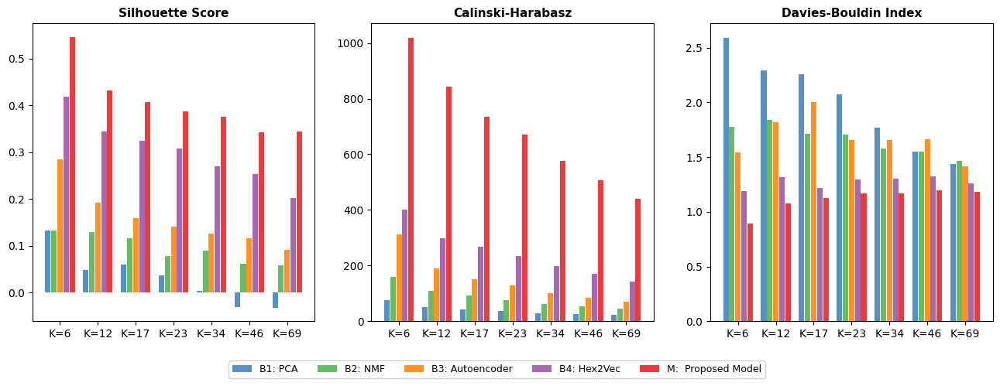
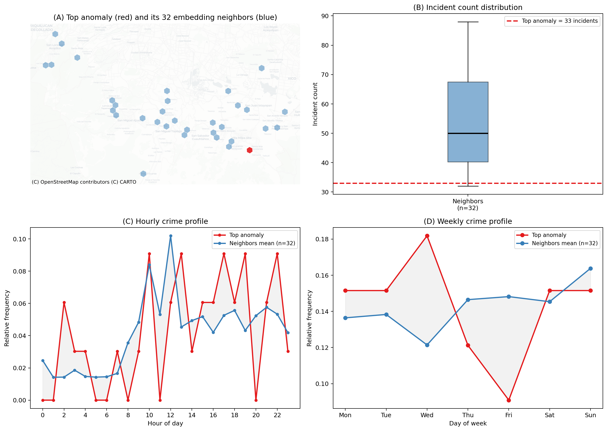
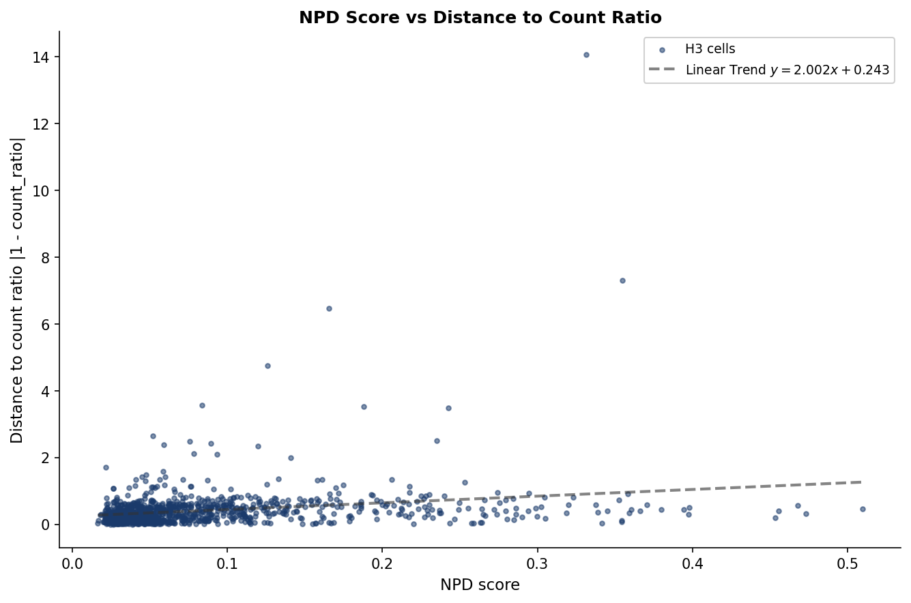
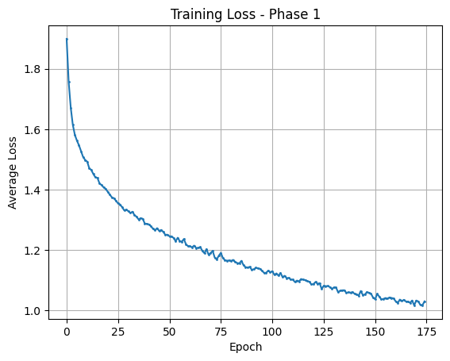
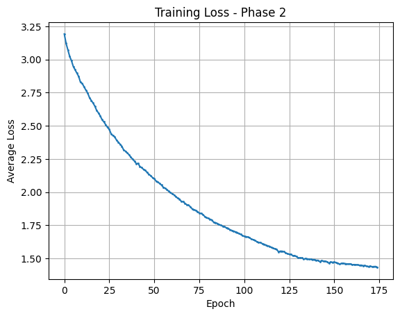

# Urban Representation Learning for Identifying Potential Disparities in Crime Reporting

Code, trained embeddings and supplementary figures for the paper of the same name.

The pipeline learns a 32-dimensional embedding for each H3 hexagonal cell in Mexico City from reported-crime records published by the Fiscalía General de Justicia (FGJ-CDMX). Embeddings are trained with a self-supervised objective based on geographic adjacency, evaluated against four baselines by clustering quality, and then used to compute a per-cell divergence score (Neighbor Profile Divergence, NPD) that compares each cell's reporting profile with that of its nearest cells in embedding space.

The current run covers **1,058 cells** at H3 resolution 8 and **38 crime categories**.

## Contents

- [Pipeline](#pipeline)
- [Results](#results)
- [Supplementary figures](#supplementary-figures)
- [Repository layout](#repository-layout)
- [Installation](#installation)
- [Usage](#usage)
- [Configuration](#configuration)
- [Data](#data)
- [Interpretation](#interpretation)
- [Limitations](#limitations)
- [Citation](#citation)

## Pipeline

1. **Loading** (`src/data/loader.py`, `src/data/taxonomy.py`). Reads the FGJ CSV, casts dates and coordinates, derives hour-of-day and day-of-week, and maps the free-text `delito` field to 38 standard categories through `CRIME_TAXONOMY`. Rows without coordinates, timestamp, or a mapped category are dropped.

2. **Features** (`src/features/hex_features.py`). Each event is assigned to an H3 cell at resolution 8 (about 0.74 km²). Cells with fewer than 30 events are discarded. For each remaining cell, three feature matrices are built:

   | Matrix | Shape | Contents |
   |---|---|---|
   | `hourly_matrix` | N × 24 | hour-of-day distribution |
   | `weekly_matrix` | N × 10 | day-of-week distribution; log weekday/weekend ratio; day-of-week entropy; weekend share |
   | `static_matrix` | N × 45 | crime-type proportions (38); violent share; type entropy; hour entropy; severe-crime share; median reporting delay; same-day report fraction; yearly trend slope |

   All entries are proportions or derived statistics. Event volume is not an input feature. Each matrix is standardised independently before training.

3. **Phase 1** (`src/models/phase1.py`). Three MLP encoders, one per matrix, produce embeddings of dimension 32, 8 and 64. Training pairs are geographic: ring-1 H3 neighbours are positives, three cells sampled outside radius 2 are negatives. Each encoder is trained with binary cross-entropy on the sigmoid of the pair dot product; the three losses are summed.

4. **Phase 2** (`src/models/phase2.py`). Each Phase 1 embedding passes through an autoencoder with an 8-dimensional latent. The three latents are fused by a self-attention layer into the final 32-dimensional embedding. The loss is `α · reconstruction + (1 − α) · NT-Xent`, where the contrastive positives are the same cell seen through different views and α is a learned parameter. In the current run α converged to 0.708.

5. **Evaluation** (`src/pipeline/evaluate.py`, `src/evaluation/`). KMeans is run on the final embedding and on four baselines (PCA, NMF, dense autoencoder, Hex2Vec over the concatenated profile) for a set of K values centred on √(N/2). Silhouette, Calinski–Harabasz and Davies–Bouldin are reported for each.

6. **Anomaly detection** (`src/pipeline/detect_anomalies.py`, `src/anomaly/`). For each cell, its k = 32 nearest cells by cosine distance in the final embedding are retrieved. The expected profile is the similarity-weighted mean of their profiles, and NPD is `1 − ⟨profile, expected profile⟩`. The top 5% of cells by NPD are flagged as candidates. A sensitivity sweep over k and a comparison against the observed/expected count ratio are also produced.

7. **Tuning** (`src/pipeline/tune.py`, `src/tuning/`). Optuna search over Phase 1 and Phase 2 hyperparameters, scored by mean silhouette. Independent of the main pipeline; writes only to `src/outputs/tuning/`.

The terms "scale" and "multi-scale" in the code (`ScaleEmbedder`, `contrastive_loss_scales`) refer to the three feature views above, not to multiple spatial resolutions. A single H3 resolution and a single neighbourhood radius are used throughout.

## Results

### Clustering quality



*Silhouette (higher is better), Calinski–Harabasz (higher is better) and Davies–Bouldin (lower is better) for K ∈ {6, 12, 17, 23, 34, 46, 69}. The proposed model obtains the best value of all three metrics at every K.*

Mean silhouette over the K sweep for the tuned models, all at 32 output dimensions (`src/outputs/tuning/best_params.json`):

| Method | Mean silhouette |
|---|---:|
| M: Proposed model | 0.4408 |
| B4: Hex2Vec | 0.3141 |
| B3: Autoencoder | 0.1590 |

The full comparison table including PCA and NMF is printed by `python -m src.pipeline.evaluate`.

### Sensitivity of NPD to k

| k | Spearman ρ vs k = 32 | Top-5% overlap |
|---:|---:|---:|
| 10 | 0.9720 | 0.8846 |
| 16 | 0.9865 | 0.9231 |
| 22 | 0.9938 | 0.9615 |
| 32 | 1.0000 | 1.0000 |
| 45 | 0.9951 | 1.0000 |

### NPD and count ratio

Spearman correlation between NPD and |1 − count_ratio| over all cells: ρ = 0.358, p < 10⁻⁶.

### Highest-NPD cells

| hex_id | Alcaldía | NPD | Observed | Expected | Ratio |
|---|---|---:|---:|---:|---:|
| `8849958069fffff` | Milpa Alta | 0.5097 | 33 | 60 | 0.538 |
| `884995b229fffff` | Cuajimalpa de Morelos | 0.4730 | 45 | 65 | 0.680 |
| `884995b115fffff` | Miguel Hidalgo | 0.4678 | 36 | 80 | 0.441 |
| `884986492dfffff` | Tlalpan | 0.4557 | 32 | 52 | 0.602 |
| `8849958055fffff` | Milpa Alta | 0.4535 | 43 | 52 | 0.799 |
| `8849958607fffff` | Tlalpan | 0.3978 | 36 | 70 | 0.500 |
| `884995b945fffff` | Venustiano Carranza | 0.3976 | 221 | 315 | 0.699 |
| `88499581dbfffff` | Xochimilco | 0.3943 | 35 | 62 | 0.550 |
| `8849958f51fffff` | Tláhuac | 0.3797 | 34 | 60 | 0.556 |
| `884995ba1bfffff` | Miguel Hidalgo | 0.3706 | 226 | 551 | 0.409 |

Expected count is the similarity-weighted mean of the peers' observed counts. The lowest-NPD cells (0.017–0.022) are high-volume cells in Iztacalco, Iztapalapa, Gustavo A. Madero and Venustiano Carranza. The full ranked table is printed by `python -m src.pipeline.detect_anomalies`.

## Supplementary figures

These figures are produced by the pipeline and do not appear in the paper.

**NPD map.** All 1,058 cells coloured by NPD; the top 5% are outlined in black.


**Case study, highest-NPD cell** (`8849958069fffff`, Milpa Alta). (A) The cell and its 32 nearest cells in embedding space. (B) Observed count against the distribution of peer counts. (C) Hourly profile of the cell against the peer mean. (D) Weekly profile against the peer mean.



The same decomposition for the second- and third-ranked cells: [`top_anomaly_profile_2.png`](src/outputs/figures/anomaly_detection/top_anomaly_profile_2.png), [`top_anomaly_profile_3.png`](src/outputs/figures/anomaly_detection/top_anomaly_profile_3.png).

**NPD against count-ratio distance.**



**Sensitivity sweep** (figure form of the table above).


**Training loss**, Phase 1 and Phase 2.

 

## Repository layout

```
run_pipeline.py              entry point: train → evaluate → detect_anomalies
src/
  config.py                  paths and hyperparameters (dataclasses)
  data/
    loader.py                CSV loading, dtypes, temporal features
    taxonomy.py              CRIME_TAXONOMY: delito text → 38 categories
  features/
    hex_features.py          H3 assignment and per-cell feature matrices
  models/
    phase1.py                per-view encoders, geographic pair sampling
    phase2.py                autoencoders and attention fusion
    baselines.py             PCA, NMF, dense autoencoder, Hex2Vec
  pipeline/
    train.py                 Phase 1 + Phase 2, writes embeddings
    evaluate.py              clustering benchmark
    detect_anomalies.py      NPD, sensitivity, figures
    tune.py                  Optuna search
    run_all.py               stage orchestration
  evaluation/                clustering metrics and report tables
  anomaly/                   NPD computation and plots
  tuning/                    Optuna search space and objective
  common/                    logging, artifact I/O, plotting helpers
  outputs/
    embeddings/              final_emb.npy, E_h/E_w/E_s.npy, hex_ids.json, metadata.json
    figures/                 all figures shown above
    tuning/best_params.json  Optuna results
data/
  carpetasFGJ_pipeline.csv   FGJ dataset (Git LFS)
```

Everything under `src/outputs/` is regenerated by a full pipeline run.

## Installation

Python 3.13. Main dependencies: PyTorch 2.12, h3 4.4, scikit-learn 1.8, GeoPandas 1.1, Optuna 5.0, contextily. CPU is sufficient; CUDA is used when available.

```bash
git clone <repository-url>
cd Urban-Representation-Learning-for-Identifying-Potential-Disparities-in-Crime-Reporting
python -m venv .venv && source .venv/bin/activate
pip install -r requirements.txt
```

The dataset (about 560 MB) is stored with Git LFS:

```bash
git lfs install
git lfs pull
```

## Usage

```bash
python run_pipeline.py                                 # full pipeline
python run_pipeline.py --skip-train --skip-evaluate    # anomaly detection only, using saved embeddings

python -m src.pipeline.train
python -m src.pipeline.evaluate
python -m src.pipeline.detect_anomalies
python -m src.pipeline.tune                            # hyperparameter search (slow)
```

Trained embeddings for the current run are committed under `src/outputs/embeddings/`. `hex_ids.json` gives the row order of `final_emb.npy`, so the embedding can be joined to H3 cell IDs without retraining.

## Configuration

All settings are in `src/config.py`.

| Parameter | Value | Description |
|---|---|---|
| `features.resolution` | 8 | H3 resolution |
| `features.min_events` | 30 | minimum events per cell |
| `phase1.k_ring` | 1 | ring distance for positive pairs |
| `phase1.n_neg` | 3 | negatives per cell |
| `phase1.emb_dim_h/w/s` | 32 / 8 / 64 | Phase 1 embedding sizes |
| `phase2.latent_dim` | 8 | autoencoder latent size |
| `phase2.final_dim` | 32 | final embedding size |
| `anomaly.k_value` | 32 | peers per cell for NPD |
| `anomaly.top_percentile` | 0.05 | fraction flagged as candidates |
| `seed` | 32 | training seed (42 for evaluation and tuning) |

Learning rates and epoch counts in `config.py` are the values found by the Optuna search in `src/outputs/tuning/best_params.json` (40 trials). `eval.k_values` is a fallback; the K sweep is computed from N by `suggest_k_values()` at run time.

## Data

`data/carpetasFGJ_pipeline.csv` contains investigation-file records (*carpetas de investigación*) published by FGJ-CDMX: offence description, timestamp of the incident and of the report, coordinates, and administrative unit. No personal identifiers are included.

Offence descriptions not present in `CRIME_TAXONOMY` are dropped at load time. The loader logs the number of dropped rows; check this when running on newer data.

## Interpretation

The data record reports, not incidents. A cell with few reports may have few incidents, limited access to reporting, or low institutional trust; the data do not distinguish these.

NPD identifies cells whose reporting profile differs from that of cells the model considers similar. Land use, daytime versus resident population, commercial density and reporting infrastructure are not modelled and can produce high NPD in the absence of any reporting disparity. A high score indicates a cell to examine with additional data, not a finding about that cell.

## Limitations

- The embedding and the NPD profile are built from the same three feature matrices, with different normalisation. Cells are therefore close in embedding space in part because their profiles are similar, which reduces the residual that NPD measures. The Phase 1 objective is geographic rather than reconstructive, so the embedding does not reproduce the profile directly, but the overlap should be taken into account when reading NPD magnitudes.
- Median reporting delay and same-day report fraction are included in `static_matrix` and therefore in the encoder input. The results reported here were produced with these features present. Removing them from the encoder input while keeping them in the compared profile is planned.
- The expected profile is a weighted mean of unit-norm vectors and is not renormalised, so NPD increases with disagreement among peers as well as with the cell's own divergence.
- There are no automated tests. Changes to features or models should be checked by rerunning the pipeline and inspecting `src/outputs/`.
- No license file is included yet.

## Citation

```bibtex
@misc{urban_representation_learning_cdmx_2026,
  title = {Urban Representation Learning for Identifying Potential Disparities in Crime Reporting},
  year  = {2026},
  note  = {Manuscript in preparation}
}
```

## Acknowledgments

Data: Fiscalía General de Justicia de la Ciudad de México. Spatial indexing: [H3](https://h3geo.org/). Basemaps in figures: OpenStreetMap contributors, CARTO.
